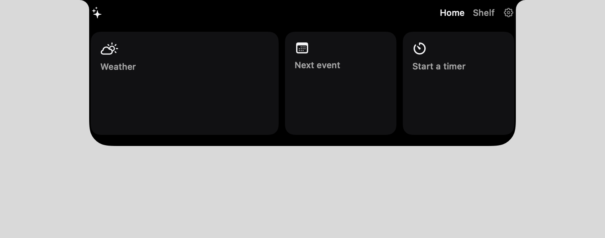
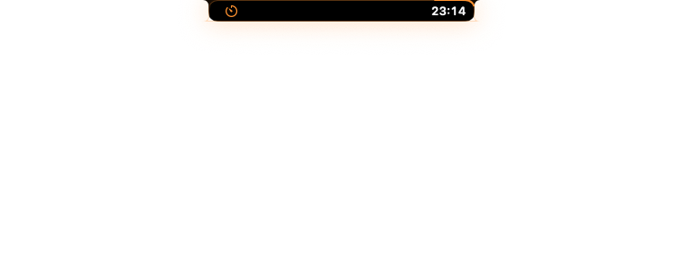
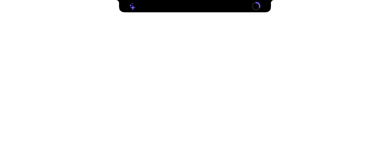
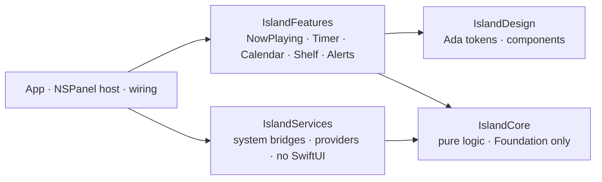

<div align="center">



<p>
  
  
  
  
</p>

<p><em>A premium "island" around the MacBook notch, built natively with SwiftUI and AppKit.<br>
Fast, quiet when idle, sandboxed, and designed to feel like it shipped with the Mac.</em></p>



</div>


## What it is

*Lunula* is Latin for "little moon": the crescent of light at the edge of a dark shape. The app turns the dark shape at the top of your screen into a living island that shows what matters now and expands when you reach for it.

It is built under strict rules: **App Sandbox and Hardened Runtime from the first commit, no private APIs, no telemetry, one small dependency.** On Macs without a notch, the island sits as a panel at the top of the screen.


## Features

| | |
|---|---|
| **Now Playing** | The current track with artwork, inline player volume slider, two-line synced lyrics and controls. |
| **Timer** | Focus timer, configurable Pomodoro durations, 7-day streak chart and drift-free stopwatch. |
| **Calendar & Reminders** | Full-day schedule agenda with Join buttons and opt-in two-way Apple Reminders sync. |
| **Shelf** | Drop files onto the island, convert images offline, archive ZIPs, run Vision OCR and AirDrop. |
| **Weather** | Local conditions through Open-Meteo (automatic or manual city), keyless, behind a provider protocol. |
| **Alerts and signals** | Battery, Bluetooth audio connect alerts with battery level, external drives and privacy dots. |
| **Custom activities & AI hooks** | Drive the island via `lunula://` URLs, App Intents and ready-to-use Claude Code / Codex hooks (`examples/hooks/`). |
| **Tools** | Small sandbox-safe utilities a click away. |
| **Ada design system** | A custom visual language with its own settings and onboarding. |

<table>
  <tr>
    <td width="50%"></td>
    <td width="50%"></td>
  </tr>
  <tr>
    <td align="center"><code>timer</code> · compact island</td>
    <td align="center"><code>custom activity</code> · via lunula://</td>
  </tr>
</table>


## Architecture



Four local Swift packages, generated into an Xcode project with XcodeGen so parallel work never fights over `.pbxproj`. Features never see Services directly; the app's composition root wires them together, and an architecture guard script enforces it.


## Rules it is built under

| Rule | How it is enforced |
|---|---|
| **Quiet when idle** | `Scripts/perf/measure-idle.sh --assert-idle` samples the running app with `top` and fails if the median CPU is above 0.1 % or there is more than one idle wake-up per second. |
| **Sandboxed from day one** | App Sandbox and Hardened Runtime on every build; no private APIs, no telemetry, one small dependency. |
| **Guarded architecture** | `check-architecture.sh` fails the build if IslandCore imports anything beyond Foundation and Observation, if Features import Services, if Services import SwiftUI, if a private API or process escape appears, or if code hops synchronously onto the main queue. |
| **Reproducible project** | `Lunula.xcodeproj` is generated with XcodeGen, and CI checks that the generated plist and entitlements are committed. |
| **No unsigned releases** | The release workflow refuses to run unless every signing secret is present, imports the Developer ID certificate into a temporary keychain and notarises the build. |
| **Tested** | 96 test files across the four packages and the app, run in CI with a release build. |


## Türkçe özet

**Lunula**, MacBook çentiğinin etrafında yaşayan, tamamen yerel (SwiftUI + AppKit) bir "ada" uygulaması. Çalan müzik, zamanlayıcı, takvim, dosya rafı, hava durumu ve sistem uyarıları çentikte küçük, üzerine gelince büyük görünüyor. İlk günden App Sandbox açık, özel API kullanmıyor, telemetri yok. Boştayken işlemciyi neredeyse hiç kullanmayacak şekilde ölçülerek geliştirildi. Türkçe ve İngilizce.


## Install

Once a signed release is published on [GitHub Releases](https://github.com/kutluhangil/Lunula/releases):

- **Direct DMG:** Download `Lunula-<version>.dmg`, drag `Lunula.app` to `Applications`, and verify against `SHA256SUMS.txt`.
- **Homebrew Cask:** Install from the release cask (`Casks/lunula.rb`):
  ```sh
  brew install --cask ./Casks/lunula.rb
  ```

## Build and test

macOS only, Xcode 26+.

```sh
Scripts/bootstrap.sh                                      # installs xcodegen, generates Lunula.xcodeproj
swift test --package-path Packages/IslandCore             # core logic
Scripts/test-all.sh                                       # all packages + app tests
xcodebuild -project Lunula.xcodeproj -scheme Lunula -destination 'platform=macOS' build test
Scripts/lint.sh && Scripts/check-architecture.sh          # format + architecture guard
Scripts/perf/measure-idle.sh --seconds 60 --assert-idle   # idle CPU and wake-ups budget
```

<div align="center">
<br>
<a href="https://github.com/kutluhangil"></a>
<sub>Sandboxed · no private API · no telemetry · MIT licensed · the track in the banner is invented.</sub>
</div>
